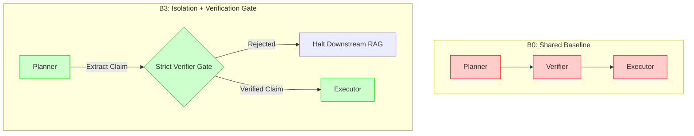

<div align="center">
  <h1>🛡️ AgentOS / IsoBench</h1>
  <p><strong>A Confound-Free Laboratory Instrument for Evaluating Error Propagation in Multi-Agent RAG Systems</strong></p>
  
  [](https://www.python.org/)
  [](https://opensource.org/licenses/MIT)
  []()
</div>

<br>

## 📖 Overview

**IsoBench** is a pure, minimal Python evaluation framework designed to empirically test **Error Propagation** and **Context Isolation** in multi-agent Retrieval-Augmented Generation (RAG) architectures. 

It was built specifically to evaluate the **AgentOS** architectural hypothesis: *In compound AI systems, an upstream hallucination guarantees downstream systemic failure unless strict topological isolation and verification gates are enforced.*

By completely avoiding bulky frameworks like LangChain or AutoGen, IsoBench acts as a mathematically pure laboratory instrument.

---

## 🔬 Methodology: The Counterfactual Dataset

Standard datasets (like HotpotQA) are highly compromised. Modern LLMs have memorized Wikipedia, allowing them to bypass corrupted RAG context using pre-trained weights (the "cheat sheet" effect). 

IsoBench solves this via a **Counterfactual Dataset**:
* **Fictional Entities**: Questions use entirely fictional names (e.g., *The Aether Diaries*).
* **Parametric Blinding**: The LLM possesses exactly zero prior knowledge, guaranteeing 100% reliance on the provided context.
* **Controlled Injections**: The dataset splits evidence into `hop1`, `hop2_correct`, and `hop2_injected` to perfectly simulate a multi-hop RAG retrieval failure.

---

## 🏗️ The 4-Arm Architectural Ablation

IsoBench evaluates identical questions across four distinct agentic paradigms:



1. **$B_0$ (Shared Baseline)**: The standard approach. All agents see the entire global reasoning history and raw scratchpad. Highly vulnerable to cascading hallucinations.
2. **$B_1$ (Isolated Verifier)**: A diagnostic architecture where the Verifier is isolated from the reasoning trace to prevent sycophancy, but the Planner remains vulnerable.
3. **$B_2$ (Isolation Only)**: Planners only see verified, structured claims rather than raw reasoning traces. 
4. **$B_3$ (Isolation + Verification Gate)**: The robust architecture. Planners only see verified claims, AND claims must pass a strict boolean gate. *Crucially, IsoBench proves that $B_3$ only succeeds if it enforces Strict Retrieval Isolation (halting downstream search upon rejection).*

---

## ⚙️ Installation & Usage

### Prerequisites
* Python 3.10+
* `requests` (for local Ollama execution)
* [Ollama](https://ollama.com/) running `llama3.1` (or your preferred local model).

### Quick Start

1. **Clone the repository:**
   ```bash
   git clone https://github.com/HamseMoismaila/HamzeOS.git
   cd HamzeOS/agent_os
   ```

2. **Run the Benchmark (Local Llama 3.1):**
   ```bash
   # On Windows (PowerShell)
   $env:AGENT_LLM_BACKEND="ollama"
   python run_isobench.py
   
   # On Linux/Mac
   AGENT_LLM_BACKEND=ollama python run_isobench.py
   ```

### Output Interpretation
The script outputs the exact reasoning trace, the verifier's extraction, and the Executor's Final Answer for all 4 architectures under both `clean` and `injected` conditions. Calculate the system's **Error Propagation Rate (EPR)** by observing the Final Answer under the injected conditions.

---

<div align="center">
  <i>Developed for the KAIST AgentOS Research Paper</i>
</div>
