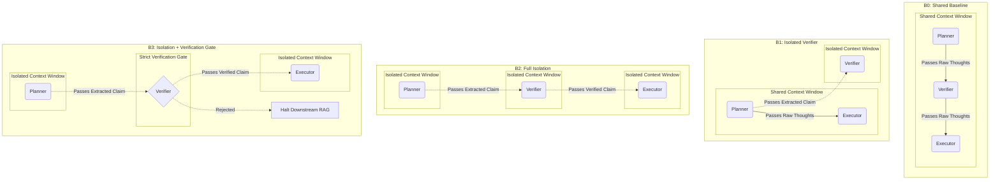

<div align="center">
  <h1>🛡️ IsoBench</h1>
  <p><strong>A Confound-Free Laboratory Instrument for Evaluating Error Propagation in Multi-Agent RAG Systems</strong></p>
  
  [](https://www.python.org/)
  [](https://opensource.org/licenses/MIT)
  []()
</div>

<br>

## 📖 Overview

**IsoBench** is a pure, minimal Python evaluation framework designed to empirically test **Error Propagation** and **Context Isolation** in multi-agent Retrieval-Augmented Generation (RAG) architectures. 

It was built specifically to evaluate compounding hallucinations in compound AI systems, demonstrating that without strict topological isolation, an upstream hallucination guarantees a downstream systemic failure.

By completely avoiding bulky frameworks like LangChain or AutoGen, IsoBench acts as a mathematically pure laboratory instrument.

---

## 🔬 Methodology: The Counterfactual Dataset

Standard datasets (like HotpotQA) are highly compromised. Modern LLMs have memorized Wikipedia, allowing them to bypass corrupted RAG context using pre-trained weights (the "cheat sheet" effect). 

IsoBench solves this via a **Counterfactual Dataset**:
* **Fictional Entities**: Questions use entirely fictional names (e.g., *The Aether Diaries*).
* **Parametric Blinding**: The LLM possesses exactly zero prior knowledge, guaranteeing 100% reliance on the provided context.
* **Controlled Injections**: The dataset splits evidence into `hop1`, `hop2_correct`, and `hop2_injected` to perfectly simulate a multi-hop RAG retrieval failure.

---

## 🏗️ The 4-Arm Architectural Ablation

IsoBench evaluates identical questions across four distinct agentic paradigms. This diagram explicitly visualizes the **Context Windows**. Agents inside the same "Shared Context" box can see each other's raw thoughts, while agents in "Isolated Context" boxes are blinded to everything except the specific claim passed to them.



### Architectural Breakdown ($B_0$ through $B_3$):

1. **$B_0$ (Shared Baseline)**: Highly vulnerable. All agents live in one Shared Context Window. The Verifier and Executor agents read the Planner's full, raw "thought process". If the Planner hallucinates, the downstream agents get infected via context contamination.
2. **$B_1$ (Isolated Verifier)**: Diagnostic. The Verifier is placed in an Isolated Context Window so it cannot be influenced by the Planner's confident thoughts (preventing sycophancy). However, the Executor still lives in the Shared Context Window and remains vulnerable.
3. **$B_2$ (Isolation Only)**: Structural cut-off. Every agent is placed in its own Isolated Context Window. Downstream agents only see structured, extracted claims. The raw reasoning trace is completely purged from the pipeline.
4. **$B_3$ (Isolation + Verification Gate)**: The robust architecture. Context is fully isolated AND claims must pass a strict boolean gate. *Crucially, IsoBench proves that $B_3$ only succeeds if it enforces Strict Retrieval Isolation (halting downstream RAG search upon rejection).*

---

## ⚙️ Installation & Usage

### Prerequisites
* Python 3.10+
* `requests` (for local Ollama execution)
* `anthropic` (if using Claude API)
* A local instance of [Ollama](https://ollama.com/) running `llama3.1` OR an Anthropic API Key for **Claude 3.5 Sonnet**.

### Quick Start

1. **Clone the repository:**
   ```bash
   git clone https://github.com/HamseMoismaila/IsoBench.git
   cd IsoBench
   ```

2. **Option A: Run with Anthropic API (Claude 3.5 Sonnet)**
   IsoBench defaults to using Claude via the Anthropic API for maximum reasoning capability.
   ```bash
   # On Windows (PowerShell)
   $env:ANTHROPIC_API_KEY="your-api-key-here"
   python run_isobench.py
   
   # On Linux/Mac
   export ANTHROPIC_API_KEY="your-api-key-here"
   python run_isobench.py
   ```

3. **Option B: Run with Local LLMs (Ollama / Llama 3.1)**
   You can easily swap out the backend to run entirely locally using Ollama.
   ```bash
   # On Windows (PowerShell)
   $env:AGENT_LLM_BACKEND="ollama"
   python run_isobench.py
   
   # On Linux/Mac
   AGENT_LLM_BACKEND=ollama python run_isobench.py
   ```

### Output Interpretation
The script outputs the exact reasoning trace, the verifier's extraction, and the Executor's Final Answer for all 4 architectures under both `clean` and `injected` conditions. Calculate the system's **Error Propagation Rate (EPR)** by observing the Final Answer under the injected conditions.
