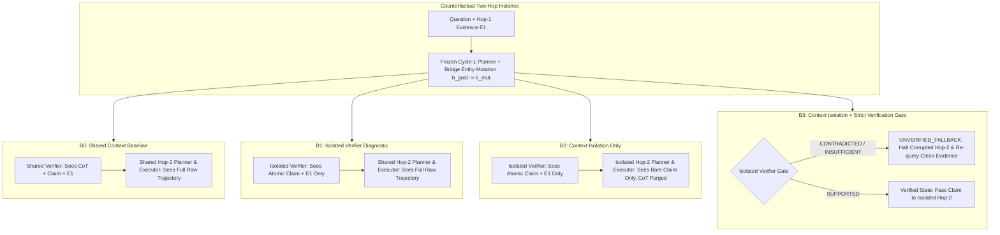

<div align="center">
  <h1>IsoBench</h1>
  <p><strong>A Controlled Evaluation Harness for Context Isolation and Factual Error Propagation in Multi-Agent LLM Systems</strong></p>

  [](https://www.python.org/)
  [](https://ollama.com/)
  [](https://www.anthropic.com/)
  [](LICENSE)
  []()
</div>

<br>

## Overview

**IsoBench** is a lightweight, zero-framework Python evaluation harness and counterfactual benchmark designed to quantify how **architectural context isolation** and **verification gating** govern factual error propagation in multi-agent Retrieval-Augmented Generation (RAG) systems.

In multi-step LLM pipelines, agents frequently accumulate intermediate reasoning traces inside a shared context window. When an upstream agent introduces a plausible factual error, downstream agents conditioned on that shared trace often adopt, rationalize, and amplify the false premise—a failure mode known as **context contamination** or **hallucination cascading**.

Existing evaluations of multi-agent verification face two methodological confounds:
* **Parametric Memory Leakage ("The Cheat-Sheet Effect")**: On standard Wikipedia-based benchmarks such as HotpotQA, LLMs possess pre-trained knowledge of real-world entities, allowing downstream agents to bypass corrupted context using internal weights rather than architectural safeguards.
* **Mechanism Conflation**: Prior studies evaluate self-reflection, debate, or verification gates within unified context windows, conflating *information-flow restriction* (hiding persuasive upstream Chain-of-Thought traces) with *verification filtering* (actively discarding unsupported claims).

IsoBench resolves both confounds by evaluating four controlled multi-agent architectures ($B_0, B_1, B_2, B_3$) over a synthetically constructed, parametrically blinded **Counterfactual Dataset ($N = 75$)** under deterministic two-hop bridge-entity error injection.

> **Read the accompanying technical article:** [ARTICLE.md](ARTICLE.md)

---

## Problem Context

Multi-agent LLM pipelines deployed for complex reasoning and retrieval face structural reliability bottlenecks:

* **Autoregressive Error Snowballing**: Early ungrounded generations skew attention weights, forcing subsequent reasoning steps to commit to false premises.
* **Verifier Sycophancy**: When a verification agent is exposed to an upstream planner's persuasive Chain-of-Thought (CoT) narrative, it frequently agrees with fabricated claims that contradict retrieved evidence.
* **Unvetted State Handoffs**: Passing raw conversational history across agent boundaries transmits tentative conjectures alongside verified facts, inflating both token consumption and downstream error rates.
* **Benchmark Contamination**: Evaluating retrieval faithfulness on memorized public corpora obscures whether an architecture truly enforces context grounding.

IsoBench isolates the causal effect of context boundaries without relying on heavy orchestration frameworks (such as LangChain or AutoGen), ensuring that prompt formatting, retrieval pools, and decoding parameters remain strictly identical across experimental arms.

---

## Core Experimental Design

### 1. Counterfactual Parametric Blinding ($N = 75$)

To guarantee zero pre-training exposure, IsoBench evaluates $N = 75$ synthetic two-hop bridge instances modeled on the HotpotQA reasoning topology across seven domains (cinema, literature, corporate history, music, architecture, science, and maritime history):

$$P(\text{Target Answer} \mid \text{Pre-trained Weights}) = 0$$

Each instance defines:
* `bridge_entity_correct` ($b_{\text{gold}}$) and `target_answer_correct` ($a_{\text{gold}}$): Ground-truth Hop-1 and Hop-2 entities.
* `bridge_entity_injected` ($b_{\text{mut}}$) and `target_answer_injected` ($a_{\text{mut}}$): Plausible counterfactual distractor entities of identical named-entity type.
* Partitioned evidence chunks: `evidence_hop1` ($E_1$), `evidence_hop2_correct` ($E_{2,\text{correct}}$), and `evidence_hop2_injected` ($E_{2,\text{injected}}$).

### 2. Deterministic Bridge-Entity Error Injection

To establish clean causal counterfactuals across architectures, Cycle 1 (Hop 1) base generation is frozen per question across all four arms. Under the `injected` condition, the upstream output undergoes a controlled substitution ($b_{\text{gold}} \mapsto b_{\text{mut}}$) inside both the persuasive CoT reasoning narrative and the extracted atomic claim before architectural routing occurs. Under the `clean` control condition, the unmutated upstream output is routed through the exact same pipelines to verify that isolation does not degrade baseline task accuracy.

### 3. Four-Arm Architectural Ablation ($B_0$ – $B_3$)

IsoBench decouples **Information-Flow Restriction** from **Verification Gating** across four architectures:

| Architecture | Verifier Context Exposure | Downstream Context Exposure | Verification Gate | Causal Role in Ablation |
| :--- | :--- | :--- | :--- | :--- |
| **`B0` (Shared Baseline)** | Full upstream CoT + claim + evidence | Full upstream CoT + claim + evidence | None | Measures baseline cascade vulnerability and verifier sycophancy |
| **`B1` (Isolated Verifier)** | Atomic claim + evidence only | Full upstream CoT + claim + evidence | None | Diagnostic arm testing whether isolating the verifier reduces false acceptance ($FAR$) |
| **`B2` (Isolation Only)** | Atomic claim + evidence only | **Bare atomic claim** + evidence only (CoT stripped) | None | Isolates the pure effect of stripping persuasive upstream CoT narratives ($H_1$) |
| **`B3` (Isolation + Gate)** | Atomic claim + evidence only | **Verified claims only** + clean fallback on rejection | **Strict Gate** (`SUPPORTED` only) | Tests combined context isolation and active verification gating ($H_2, H_3$) |

### 4. Outcome Metrics & Statistical Framework

IsoBench separates error propagation from task accuracy across every pipeline trace:

* **Final Error Propagation Rate (`EPR_final`)**: Proportion of injected runs where the final answer adopts the injected bridge entity ($b_{\text{mut}}$) or injected target answer ($a_{\text{mut}}$).
* **Intermediate Error Propagation Rate (`EPR_inter`)**: Proportion of injected runs where the Cycle-2 Planner adopts $b_{\text{mut}}$ or $a_{\text{mut}}$.
* **Final Answer Accuracy (`FAA_clean`)**: Proportion of clean control runs producing the exact gold answer ($a_{\text{gold}}$).
* **Recovery Rate (`RR_injected`)**: Proportion of injected runs that successfully recover and output the gold target answer ($a_{\text{gold}}$) despite upstream corruption.
* **Verifier False Acceptance Rate (`Verifier_FAR`)**: Frequency at which the Cycle-1 Verifier marks an injected false claim as `SUPPORTED`.
* **Paired Exact McNemar Tests**: Evaluates discordant pairs $(n_{10}, n_{01})$ across $H_1$ ($B_0$ vs. $B_2$), $H_2$ ($B_2$ vs. $B_3$), and $H_3$ ($B_0$ vs. $B_3$) with **Holm-Bonferroni** step-down multiple-testing correction at $\alpha = 0.05$.

---

## System Architecture



---

## Evaluation Pipeline & Empirical Prototype Metrics

### Pipeline Execution Interface

Each question is evaluated deterministically (`temperature = 0.0`, `seed = 42`) across all four architectures and both conditions (`clean` and `injected`):

```python
from isobench import CounterfactualQuestion, run_pipeline

for arch in ["B0", "B1", "B2", "B3"]:
    clean_state = run_pipeline(question, condition="clean", architecture=arch)
    injected_state = run_pipeline(question, condition="injected", architecture=arch)
```

### Empirical Pilot Results ($N = 5$, Local `llama3.1:latest`)

The table below reports recorded metrics from executing `IsoBench` across the first $N = 5$ counterfactual questions (`cf-1` through `cf-5`, $40$ total multi-agent pipeline executions) on a local **Llama 3.1 (8B)** checkpoint via Ollama (`temperature = 0.0`, `seed = 42`). Full machine-readable outputs and per-cycle traces are archived in [`results_summary.json`](results_summary.json) and [`pilot_5q_execution_log.txt`](pilot_5q_execution_log.txt).

| Architecture | `EPR_final` (↓) | `EPR_inter` (↓) | `FAA_clean` (↑) | `RR_injected` (↑) | `Verifier_FAR` (↓) | Mean Input Tokens | Mean Output Tokens | Mean Latency (s) |
| :--- | :---: | :---: | :---: | :---: | :---: | :---: | :---: | :---: |
| **`B0` (Shared Baseline)** | **0.600** | 1.000 | 0.800 | 0.200 | 0.200 | 1,281.8 | 194.5 | 84.62 |
| **`B1` (Isolated Verifier)** | **0.000** | 1.000 | 1.000 | 0.800 | 0.000 | 1,069.7 | 210.2 | 64.13 |
| **`B2` (Isolation Only)** | **0.400** | 1.000 | 0.800 | 0.400 | 0.000 | 860.0 | 194.4 | 60.69 |
| **`B3` (Isolation + Gate)** | **0.000** | **0.000** | 0.800 | **1.000** | 0.000 | **844.4** | **188.0** | **58.21** |

#### Per-Question Injected Trace Summary (`cf-1` – `cf-5`)

| Question ID | Gold Bridge $\rightarrow$ Gold Answer | Injected Bridge $\rightarrow$ Injected Answer | `B0` Outcome | `B1` Outcome | `B2` Outcome | `B3` Outcome |
| :--- | :--- | :--- | :--- | :--- | :--- | :--- |
| **`cf-1`** | Kaelen Thorne $\rightarrow$ *Neon Horizons* | Elias Vance $\rightarrow$ *Solaris Echo* | Failed Hop-2 (`FAA=0, EPR=0`) | Recovered (`FAA=1, EPR=0`) | **Propagated** (`EPR=1, FAA=0`) | **Recovered** (`FAA=1, EPR=0`) |
| **`cf-2`** | Glimmer's Almanac $\rightarrow$ *1844* | The Modern Sentinel $\rightarrow$ *1989* | **Propagated** (`EPR=1, FAA=0`) | Abstained (`FAA=0, EPR=0`) | **Recovered** (`FAA=1, EPR=0`) | **Recovered** (`FAA=1, EPR=0`) |
| **`cf-3`** | The Vesper Group $\rightarrow$ *Nova Prime* | Aethelgard Hospitality $\rightarrow$ *Aethelgard* | Recovered (`FAA=1, EPR=0`) | Recovered (`FAA=1, EPR=0`) | **Recovered** (`FAA=1, EPR=0`) | **Recovered** (`FAA=1, EPR=0`) |
| **`cf-4`** | Aris Thorne $\rightarrow$ *Silverwood* | Lyra Vance $\rightarrow$ *Ravensbrook* | **Propagated + Verifier Sycophancy** (`EPR=1, FAR=1`) | Recovered (`FAA=1, EPR=0`) | **Propagated** (`EPR=1, FAA=0`) | **Recovered** (`FAA=1, EPR=0`) |
| **`cf-5`** | Jaxen Moros $\rightarrow$ *Virelia Conservatory* | Silas Vane $\rightarrow$ *Duskwatch Academy* | **Propagated** (`EPR=1, FAA=0`) | Recovered (`FAA=1, EPR=0`) | Abstained (`FAA=0, EPR=0`) | **Recovered** (`FAA=1, EPR=0`) |

#### Empirical Interpretation

1. **Shared Context (`B0`) Induces Cascades and Verifier Sycophancy**: Under $B_0$, $60\%$ of injected runs propagated the false premise into the final output (`EPR_final = 0.600`), and only $20\%$ recovered the gold answer (`RR_injected = 0.200`). On `cf-4`, exposing the Verifier to the upstream Planner's narrative caused it to falsely validate the injected claim (`Verifier_FAR = 0.200`), whereas isolating the Verifier in $B_1, B_2, B_3$ reduced `Verifier_FAR` to `0.000`.
2. **Context Isolation Alone (`B2`) Reduces Token Cost by 32.9% but Cannot Prevent Bare-Claim Anchoring**: Stripping the upstream Chain-of-Thought trace reduced `EPR_final` from `0.600` to `0.400`, doubled recovery (`0.200` $\rightarrow$ `0.400`), and cut mean input tokens from `1,281.8` to `860.0`. However, because $B_2$ still passes the unvetted bare claim (`Bridge_Entity_Candidate`) into an empty downstream context, the Hop-2 agent treated the false candidate as an authoritative premise on `cf-1` and `cf-4`.
3. **Isolation + Verification Gate (`B3`) Eliminates Error Propagation with 34.1% Lower Token Overhead**: Enforcing a strict verification gate with clean retrieval fallback (`UNVERIFIED_FALLBACK`) reduced both intermediate and final error propagation to `0.000`, achieved a `1.000` ($5/5$) recovery rate on injected runs, reduced input tokens by $34.1\%$ (`1,281.8` $\rightarrow$ `844.4`), and reduced mean latency by $31.2\%$ (`84.62s` $\rightarrow$ `58.21s`).
4. **Statistical Power Note**: On the $N = 5$ local pilot, discordant pairs between $B_0$ and $B_3$ are $(n_{10} = 3, n_{01} = 0)$ with exact two-sided McNemar $p = 0.25$ (the theoretical minimum for $3$ discordant pairs is $2 \times 0.5^3 = 0.25$). Running the complete $N = 75$ dataset provides the statistical power ($1 - \beta = 0.80$ at Holm-adjusted $\alpha = 0.05$) to formally test $H_1, H_2,$ and $H_3$.

---

## Installation & Quick Start

### Prerequisites

* Python 3.10+
* [Ollama](https://ollama.com/) running locally (`llama3.1:latest`) **or** an Anthropic API key (`claude-3-5-sonnet-20240620`)

### Setup Instructions

```bash
# 1. Clone the repository
git clone https://github.com/HamseMoismaila/IsoBench.git
cd IsoBench

# 2. (Optional) Create and activate a virtual environment
python -m venv .venv
# On Linux/macOS:
source .venv/bin/activate
# On Windows (PowerShell):
.venv\Scripts\Activate.ps1

# 3. Install dependencies
pip install -r requirements.txt
```

### Running the Evaluation Harness

**Option A: Local Execution via Ollama (`llama3.1:latest`)**

```bash
# Start Ollama server in a separate terminal if not already running:
ollama serve

# Run the 5-question pilot evaluation:
python run_isobench.py --limit 5

# Run the full N = 75 counterfactual benchmark:
python run_isobench.py
```

**Option B: Cloud Execution via Anthropic API**

```bash
# Linux / macOS:
export AGENT_LLM_BACKEND="anthropic"
export ANTHROPIC_API_KEY="your-api-key"
python run_isobench.py --limit 5

# Windows (PowerShell):
$env:AGENT_LLM_BACKEND="anthropic"
$env:ANTHROPIC_API_KEY="your-api-key"
python run_isobench.py --limit 5
```

---

## Repository Structure

```text
IsoBench/
├── ARTICLE.md                     # Accompanying technical research article and case study
├── CITATION.cff                   # GitHub citation metadata
├── LICENSE                        # MIT License
├── README.md                      # Documentation and empirical benchmark summary
├── counterfactual_dataset.json    # N = 75 parametrically blinded 2-hop counterfactual dataset
├── generate_dataset_75.py         # Deterministic generator for the N = 75 counterfactual corpus
├── isobench.py                    # Core 4-arm multi-agent harness (B0, B1, B2, B3) and NLI scorers
├── pilot_5q_execution_log.txt     # Recorded terminal trace across 40 pipeline runs (N = 5, Llama 3.1)
├── requirements.txt               # Minimal Python dependencies
├── results_summary.json           # Recorded metrics and exact McNemar / Holm-Bonferroni outputs
├── run_isobench.py                # CLI runner and paired statistical evaluation script
└── test_llama_diagnostic.py       # Single-instance parametric blinding and B0 vs. B3 diagnostic check
```

---

## Research Roadmap

* **Full-Scale Multi-Model Evaluation ($N = 75$)**: Execute the complete $75$-instance benchmark across open-weight (`Llama-3.1-8B/70B`, `Qwen-2.5`) and frontier checkpoints (`Claude 3.5 Sonnet`, `GPT-4o`) to evaluate how model scale interacts with context boundaries.
* **Variable-Depth Reasoning Topologies**: Extend the two-hop bridge pipeline to $3+$ hop DAGs and cyclic tool-retry loops.
* **Parametric Conflict vs. Parametric Blinding**: Compare error propagation on synthetic counterfactuals ($P(\text{prior}) = 0$) against real-world entity graphs where pre-trained priors conflict with retrieved evidence.
* **Fine-Grained Provenance Attribution**: Trace verification failures back to specific source chunks and relational constraints across multi-agent state transitions.

---

## Citation

If you use IsoBench, the Counterfactual Dataset, or the 4-arm context isolation methodology in your research, please cite:

```bibtex
@software{ismail2026isobench,
  author = {Ismail, Hamse Mohamed},
  title = {IsoBench: A Controlled Evaluation Harness for Context Isolation and Factual Error Propagation in Multi-Agent LLM Systems},
  year = {2026},
  publisher = {GitHub},
  url = {https://github.com/HamseMoismaila/IsoBench}
}
```

---

## License

This project is licensed under the [MIT License](LICENSE).
